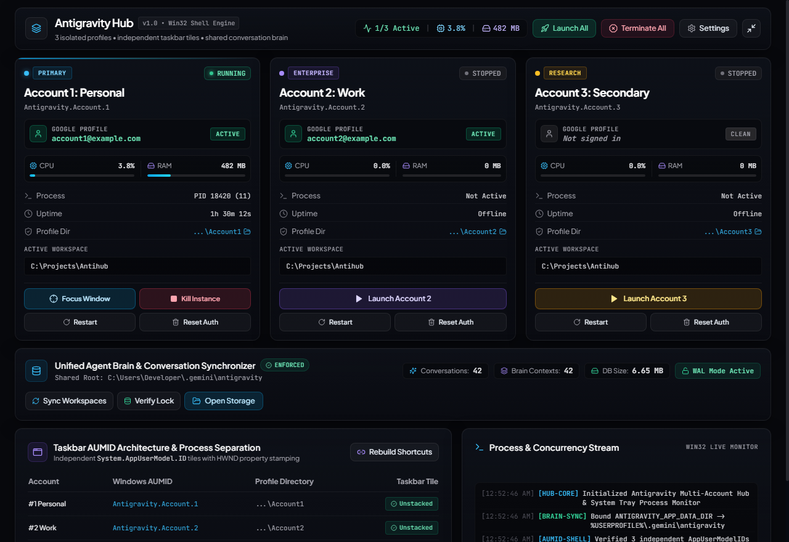

# 🚀 Antigravity Multi-Account Hub (Antihub)

[](https://microsoft.com/windows)
[](LICENSE)
[](https://dotnet.microsoft.com/)
[](https://react.dev/)

A high-performance Windows desktop orchestrator built for **Google Antigravity**. It enables developers to concurrently run up to **3 independent Google accounts** side-by-side with complete authentication isolation, unstacked Windows Taskbar tiles (distinct AppUserModelIDs), and a synchronized conversation history & agent brain.



---

## 🌟 Key Features

1. **🔐 3 Concurrent Isolated Accounts**
   - Each instance maintains its own dedicated Chromium profile (`--user-data-dir`):
     - **Account 1 (Personal):** `%APPDATA%\Antigravity-Profiles\Account1`
     - **Account 2 (Work):** `%APPDATA%\Antigravity-Profiles\Account2`
     - **Account 3 (Secondary):** `%APPDATA%\Antigravity-Profiles\Account3`
   - OAuth tokens, login cookies, and sessions remain strictly separated.

2. **🧠 Unified Agent Brain & Conversations**
   - Automatically injects and enforces:
     ```cmd
     ANTIGRAVITY_APP_DATA_DIR = "%USERPROFILE%\.gemini\antigravity"
     ```
   - All 3 instances share the same central SQLite database (`conversation_summaries.db`), saved conversations, and brain context directories.
   - Built-in SQLite WAL mode verification and lock guard.

3. **🪟 Independent Windows Taskbar Tiles (Unstacked AUMIDs)**
   - Windows normally stacks all `Antigravity.exe` windows under a single generic taskbar icon.
   - Antihub generates distinct Win32 `System.AppUserModel.ID` entries (`Antigravity.Account.1`, `Antigravity.Account.2`, `Antigravity.Account.3`) with custom badged high-res icons.
   - Automatically stamps active window handles (`HWND`) via Win32 Shell APIs (`SHGetPropertyStoreForWindow` & `WM_SETICON`) so each account appears as an independent icon on your taskbar.

4. **⚡ Background System Tray & Process Monitor**
   - Sits in the Windows notification tray next to the system clock.
   - Real-time CPU, RAM, and process polling for each account.
   - Quick actions: Launch, Focus Window (`SetForegroundWindow`), Kill, Restart, Clear Auth Cache, and Open Profile Folders.

---

## 💻 Quick Start (Ready to Run on Laptop)

For prebuilt framework-dependent releases, ensure **.NET 10 Desktop Runtime (x64)** is installed on Windows (no Node.js or SDK needed; or compile a self-contained bundle with `build.bat self-contained`):

1. Extract the downloaded `Antihub.zip` to any folder on your laptop.
2. Run **`Setup-Shortcuts.bat`** (first time only):
   - Generates the 3 isolated profiles in `%APPDATA%\Antigravity-Profiles`.
   - Creates the 3 distinct shortcuts on your Desktop and Start Menu.
3. Run **`Run-AntigravityHub.bat`**:
   - Launches the compiled native dashboard (`release\AntigravityHub.exe`).
   - Use the sleek dashboard or system tray icon to control your accounts!

---

## 🛠️ Building From Source

If you want to modify the code or contribute to the project:

### Prerequisites
- **Windows 10 / 11** (64-bit)
- **Node.js** (v18+)
- **.NET 10.0 SDK** (Desktop / Windows runtime)
- **PowerShell 5.1+**

### Build Pipeline
Run the all-in-one build script:
```cmd
build.bat
```
(Or run `build.bat self-contained` to bundle the .NET 10 runtime alongside the executable for machines without `.NET 10 Desktop Runtime`.)

This automatically:
1. Generates the isolated profiles and Win32 badged icons.
2. Builds the React + TypeScript + Tailwind CSS UI bundle into `dist/`.
3. Compiles the native C# Win32 host into `release\AntigravityHub.exe`.
4. Stages frontend assets and scripts into the `release/` bundle.

### Running Tests
```cmd
npm test
```
Runs TypeScript typechecking (`tsc --noEmit`) and the C# unit test suite (`tests/Antihub.Tests`).

---

## 📁 Repository Structure

```text
Antihub/
├── assets/                    # High-res icons (AntigravityHub.ico, Account1-3.ico)
├── release/                   # Prebuilt, ready-to-run Windows executable & runtime
│   ├── AntigravityHub.exe     # Standalone native launcher
│   ├── dist/                  # Bundled React UI
│   └── runtimes/              # Windows WebView2 & architecture runtimes
├── scripts/                   # PowerShell orchestration scripts
│   ├── generate-shortcuts.ps1 # AUMID shell shortcut generator & NTFS junction links
│   └── clean-profiles.ps1     # Stale credential cleanup utility
├── src/                       # React 19 + TypeScript + Tailwind CSS frontend
│   ├── components/            # Account cards, brain synchronizer, logs, settings
│   └── bridge/                # Bidirectional WebView2 IPC bridge
├── src-native/                # C# .NET 10 WinForms/WebView2 native host
│   ├── Program.cs             # Process manager, Win32 API hooks, system tray
│   └── AntigravityHub.csproj  # Project file
├── src-tauri/                 # Optional Tauri v2 (Rust) alternative prototype
├── tests/                     # Automated C# unit & security validation tests
├── build.bat                  # Complete build & compilation script
├── Run-AntigravityHub.bat     # 1-Click launcher
├── Setup-Shortcuts.bat        # 1-Click shortcut & profile generator
├── LICENSE                    # MIT Open Source License
└── README.md                  # Documentation (English & Arabic)
```

---

## 🇸🇦 دليل الاستخدام والتشغيل السريع (باللغة العربية)

### 📌 التشغيل الفوري على اللابتوب (بدون الحاجة لأي تثبيت أو بناء):
1. قم بفك ضغط ملف `Antihub.zip` في أي مسار تريده على اللابتوب.
2. شغّل ملف **`Setup-Shortcuts.bat`** (لمرة واحدة فقط):
   - سيقوم بإنشاء المجلدات المعزولة للحسابات الثلاثة داخل مسار `%APPDATA%\Antigravity-Profiles`.
   - سيُنشئ 3 اختصارات مستقلة على سطح المكتب لكل حساب بأيقونات ملونة وهوية مستقلة على شريط المهام (Taskbar).
3. شغّل ملف **`Run-AntigravityHub.bat`**:
   - سيفتح لوحة التحكم الاحترافية فوراً (`release\AntigravityHub.exe`).
   - يمكنك تشغيل أي حساب، مراقبة استهلاك الرام والمعالج، والتحكم بكل شيء من خلال لوحة التحكم أو أيقونة صينية النظام (System Tray) بجوار الساعة.

### 🌐 الاستعداد لرفع المشروع على GitHub:
المشروع الآن مهيأ بالكامل ليصبح مشروعاً مفتوح المصدر (Open Source):
- يحتوي على ملف ترخيص MIT (`LICENSE`).
- يحتوي على ملف `.gitignore` متكامل يستثني تلقائياً ملفات `node_modules` ومخلفات البناء المؤقتة.
- الكود منظم بدون أي مسارات ثابتة (Hardcoded paths) ويعتمد كلياً على متغيرات بيئة ويندوز الديناميكية (`%APPDATA%` و `%USERPROFILE%`).

---

## 📄 License
This project is licensed under the [MIT License](LICENSE).
