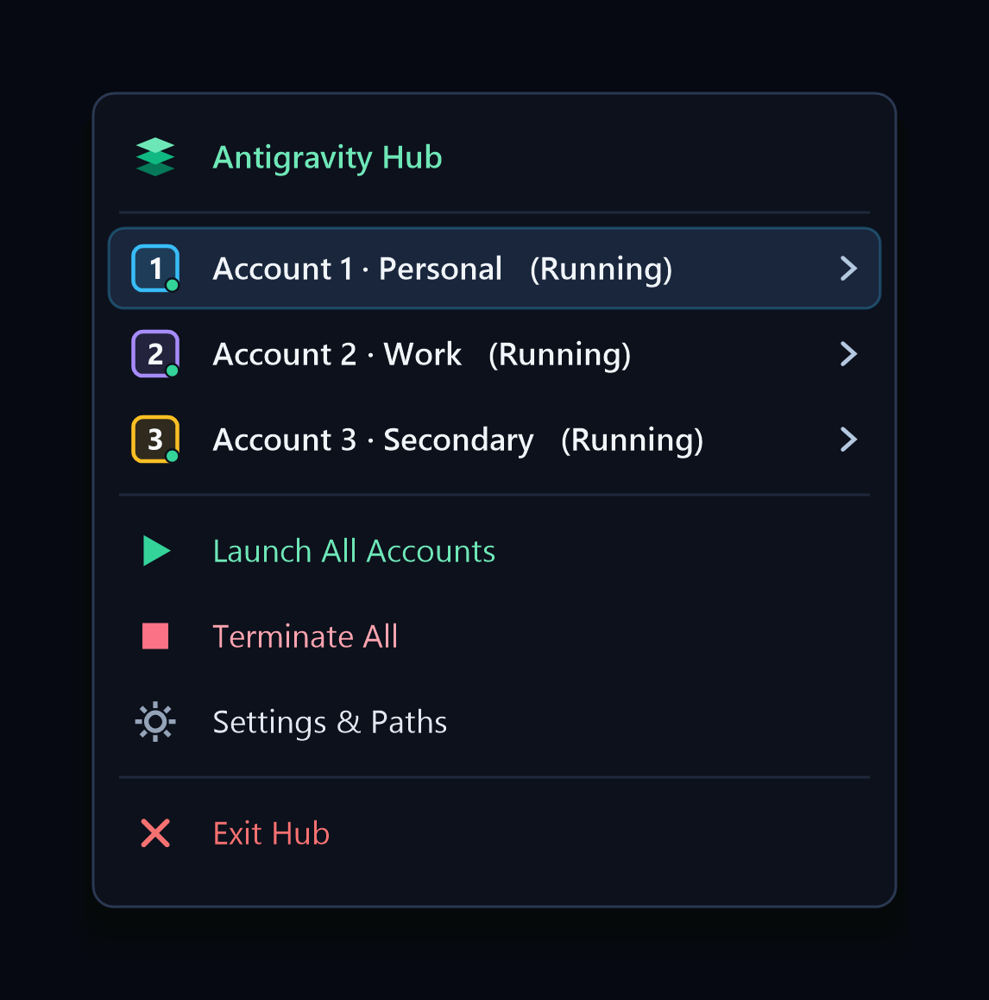

# Antigravity Multi-Account Hub (Antihub)

A Windows desktop launcher and process manager for **Google Antigravity** that lets you run up to **3 separate Google accounts** side-by-side without logging out, while keeping your conversation history and agent brain shared across all three.

## Why Antihub?

Normally, running multiple Google accounts in Antigravity means signing out or fighting Windows taskbar grouping and duplicate tray icons. Antihub solves this at the OS level:

- **Isolated Authentication (`--user-data-dir`):** Accounts 1, 2, and 3 each get their own Chromium profile under `%APPDATA%\Antigravity-Profiles\Account1..3`, keeping OAuth tokens and cookies completely separate.
- **Shared Brain & Conversations:** Sets `ANTIGRAVITY_APP_DATA_DIR` and NTFS directory junctions so all three accounts read and write to the same `%USERPROFILE%\.gemini\antigravity` directory and SQLite conversation database.
- **Separate Windows Taskbar Icons:** Generates distinct `System.AppUserModel.ID` shortcuts (`Antigravity.Account.1`, `Antigravity.Account.2`, `Antigravity.Account.3`) with custom numbered icons and stamps active window handles (`HWND`) so Windows doesn't stack them together.
- **Single System Tray Menu:** Sits in your Windows notification tray with live status, Focus/Launch/Kill/Restart controls, and hides duplicate Antigravity tray icons.

  

## Quick Start

If you downloaded a prebuilt release, make sure **.NET 10 Desktop Runtime (x64)** is installed on Windows:

1. Extract `Antihub.zip` to a folder of your choice.
2. Run **`Setup-Shortcuts.bat`** once to create the 3 isolated profile folders, icons, and taskbar shortcuts.
3. Run **`Run-AntigravityHub.bat`** to open the Hub dashboard (or manage accounts directly from the system tray icon).
